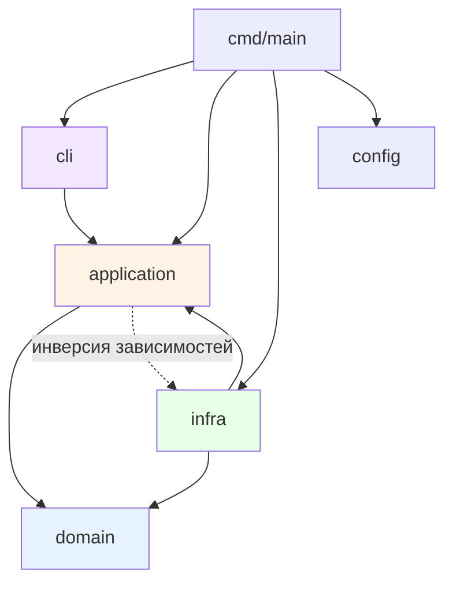
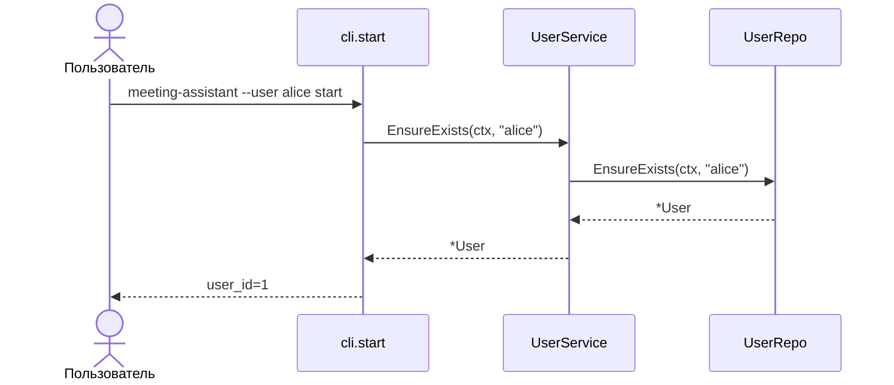
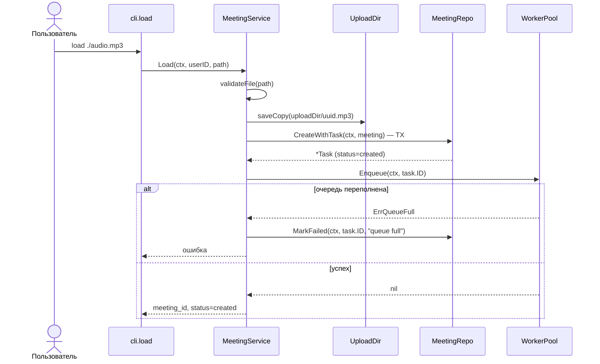
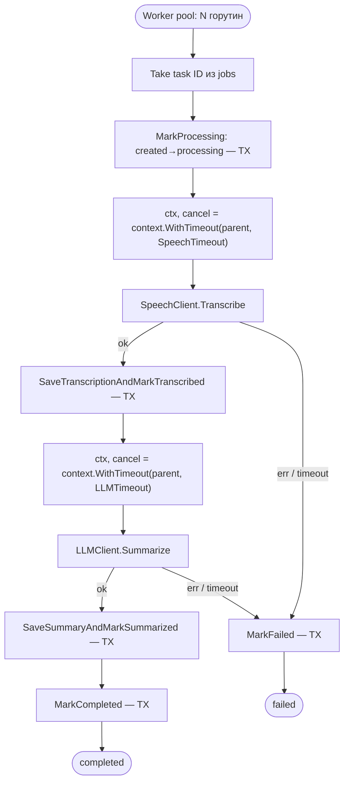
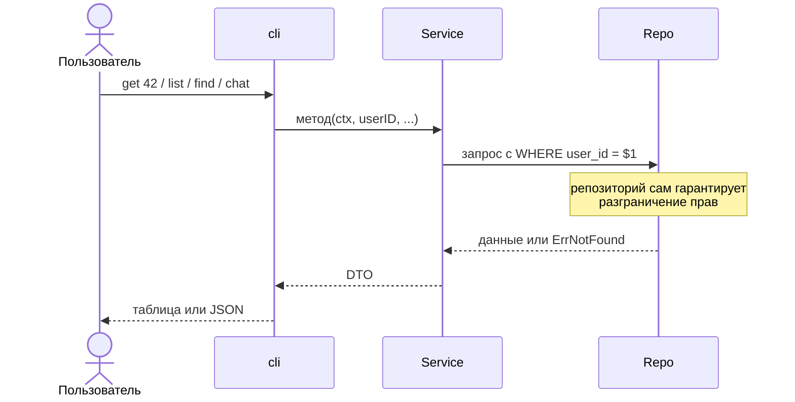

# Архитектура

Документ описывает слои приложения, направление зависимостей и ключевые
сценарии взаимодействия. Цель — отделить бизнес-логику от транспорта (CLI),
БД (PostgreSQL) и внешних API (Speech/LLM).

---

## 1. Слои

```
┌─────────────────────────────────────────────────────────────┐
│  presentation:  cmd/meeting-assistant, internal/cli         │
│  Принимает команды. Никакой бизнес-логики.                  │
└──────────────────────────┬──────────────────────────────────┘
                           │ вызывает use cases
┌──────────────────────────▼──────────────────────────────────┐
│  application: internal/application                          │
│  Use cases + порты (интерфейсы). Знает domain, не знает     │
│  infra. Никаких pgx, HTTP-деталей, io.Reader в публичных    │
│  сигнатурах сервисов.                                       │
└──────────┬──────────────────────────────────┬───────────────┘
           │                                  │
┌──────────▼──────────────┐      ┌────────────▼───────────────┐
│  domain: internal/domain │      │  ports (интерфейсы)        │
│  Сущности, статусы,      │      │  SpeechClient, LLMClient,  │
│  доменные ошибки.        │      │  UserRepo, MeetingRepo,    │
│  Без зависимостей.       │      │  TaskRepo, ChatRepo        │
└──────────────────────────┘      └────────────┬───────────────┘
                                               │ реализуется в
┌──────────────────────────────────────────────▼──────────────┐
│  infra: internal/infra                    │
│  postgres — sqlcgen + обёртки-репозитории (pgx/v5);         │
│  speech   — mock, whisper;                                  │
│  llm      — mock, openrouter.                               │
└─────────────────────────────────────────────────────────────┘
```

**Правило зависимостей:** только внутрь. `domain` не импортирует ничего
из проекта. `application` импортирует `domain`. `infra` и `cli`
импортируют `application` и `domain`. Обратного импорта нет.

**`sqlcgen` — деталь инфраструктуры.** Сгенерированный код не «протекает»
наружу: `domain` и `application` про него не знают. Обёртки `*_repo.go`
маппят `sqlcgen.*` в доменные типы и обратно.

---

## 2. Структура пакетов

```
cmd/meeting-assistant/main.go      сборка приложения, DI, graceful shutdown
internal/
  config/                          загрузка env, валидация
  domain/                          сущности, статусы, доменные ошибки
  application/                     use cases + порты
    ports.go
    user_service.go
    meeting_service.go
    chat_service.go
    worker_pool.go
  infra/
    postgres/
      schema.sql                   конечное состояние схемы (вход для sqlc)
      sqlc.yaml                    конфиг генератора
      queries/                     исходники SQL-запросов
        users.sql
        meetings.sql
        tasks.sql
        chat.sql
      sqlcgen/                     сгенерированный код (коммитится, руками не правится)
      migrations/                  golang-migrate (0001_init.up/down.sql)
      db.go                        pgxpool + запуск миграций
      repo/
        user.go                    package repo — обёртка: sqlcgen → domain
        meeting.go
        task.go
        chat.go
    speech/                        mock.go, whisper.go, factory.go
    llm/                           mock.go, openrouter.go, factory.go
  worker/
    processor.go                   pipeline: transcribe → summarize → finalize
  cli/
    root.go + по одному файлу на команду
tests/
  integration/                     TEST_DATABASE_URL (без docker)
```

---

## 3. Диаграмма зависимостей



Стрелка `application -.-> infra` — инверсия: `application` объявляет
интерфейсы, `infra` их реализует, `main.go` связывает их.

---

## 4. Потоки

### 4.1. Регистрация



`INSERT ... ON CONFLICT (external_id) DO UPDATE SET external_id = EXCLUDED.external_id RETURNING ...` — идемпотентно.

### 4.2. Загрузка и постановка в очередь



### 4.3. Асинхронная обработка



Каждый переход статуса — в транзакции; каждая транзакция включает запись
в `status_history`. Подробности — в [`STATUS_MODEL.md`](STATUS_MODEL.md).

Отмена родительского контекста (SIGTERM/SIGINT) прерывает текущий шаг;
для текущей задачи выполняется `MarkFailed(..., "shutdown")`, если она не успела.

### 4.4. Чтение результатов



**Ключевое решение:** проверка прав встроена в репозиторий. Все методы
`MeetingRepo`, принимающие `userID`, добавляют `WHERE m.user_id = $1`.
Даже если сервис забудет проверить — БД не вернёт чужие данные.

---

## 5. Обработка ошибок

```
domain.ErrNotFound        → "meeting 42 not found"        (exit 1)
domain.ErrForbidden       → "meeting 42 not yours"        (exit 1)
domain.ErrInvalidArgument → "invalid argument: ..."       (exit 2)
domain.ErrQueueFull       → "server busy, try later"      (exit 3)
```

- `fmt.Errorf("meeting_service.get: %w", err)` — оборачивание;
- проверки через `errors.Is` / `errors.As`;
- инфраструктурные ошибки → доменные: `pgx.ErrNoRows → domain.ErrNotFound`.

**Маппинг `pgx → domain` — на обёртке `*_repo.go`.** `sqlcgen` возвращает
`pgx.ErrNoRows`; обёртка переводит его в `domain.ErrNotFound`. `application`
и `domain` про `pgx` не знают.

Логи — `log/slog`, JSON. Поля: `op`, `user_id`, `meeting_id`, `task_id`,
`err`, `duration_ms`. **Никогда** не логируются `api_key`, тела ответов API
целиком, содержимое транскрипций.

---

## 6. Конкурентность

- **Worker pool** — `chan int64` с буфером `JobQueueCapacity`, `N` горутин-воркеров.
- **Enqueue** — неблокирующий `select` с `default`; если канал полон —
  `ErrQueueFull` (без создания горутин).
- **Backpressure** — через переполнение очереди, явная ошибка пользователю.
- **Per-task context** — `context.WithTimeout` на каждый шаг.
- **Graceful shutdown** — `signal.NotifyContext` → отмена корневого →
  воркеры дочитывают канал → `close(jobs)` → `wg.Wait()` с дедлайном
  `ShutdownTimeout` → `pgxpool.Close()`.

Проверки качества:
- `go test -race ./...`;
- тест на `context.WithCancel` во время `Transcribe`;
- тест на лимит параллелизма (атомик-счётчик в mock-Speech).

---

## 7. Транзакции

| Операция | Где | Атомарно |
|---|---|---|
| `CreateWithTask` | `meeting_repo.go` | `INSERT meetings` + `INSERT processing_tasks(status=created)` + `INSERT status_history` |
| `MarkProcessing` | `task_repo.go` | `UPDATE status='processing', attempts+1` + `INSERT status_history` |
| `SaveTranscriptionAndMarkTranscribed` | `task_repo.go` | `INSERT transcriptions` + `UPDATE status='transcribed'` + `INSERT status_history` |
| `SaveSummaryAndMarkSummarized` | `task_repo.go` | `INSERT summaries` + `UPDATE status='summarized'` + `INSERT status_history` |
| `MarkCompleted` | `task_repo.go` | `UPDATE status='completed'` + `INSERT status_history` |
| `MarkFailed` | `task_repo.go` | `UPDATE status='failed', error_message=$1` + `INSERT status_history` |

Реализация — `pgxpool.Begin` → `queries.WithTx(tx)` → `tx.Commit` /
`defer tx.Rollback(ctx)`. Все запросы внутри транзакции идут через
`sqlcgen.Queries`, привязанный к `tx`.

---

## 8. Фабрика клиентов по конфигу

```go
speechClient := speech.New(cfg.SpeechProvider, speech.Options{
    BaseURL: cfg.WhisperBaseURL, APIKey: cfg.WhisperAPIKey,
})
llmClient := llm.New(cfg.LLMProvider, llm.Options{...})
```

Фабрики в `infra/*/factory.go`. Замена `mock → whisper` — только
env (`MS_SPEECH_PROVIDER=whisper` + ключ). Бизнес-логика не меняется.

---

## 9. Генерация кода БД через sqlc

Слой доступа к данным использует `sqlc` как **dev-time генератор**:
SQL-запросы пишутся вручную в `queries/*.sql`, `sqlc generate` компилирует
их в типобезопасный Go-код в `sqlcgen/`. В рантайме новых зависимостей нет —
`sqlcgen` вызывает тот же `pgx/v5`, что и раньше.

### 9.1. Что где живёт

| Файл / каталог | Роль | Руками править? |
|---|---|---|
| `schema.sql` | Конечное состояние схемы (парсится sqlc) | Да, синхронизируется с `migrations/` |
| `queries/*.sql` | Источник истины для запросов | Да |
| `sqlc.yaml` | Конфиг генератора | Да |
| `sqlcgen/*.go` | Сгенерированный код | **Нет** (перезаписывается) |
| `repo/*.go` | Обёртки: маппинг `sqlcgen` → `domain`, ошибки | Да |

### 9.2. Правила

1. **`domain` и `application` не видят `sqlcgen`.** Обёртки в `postgres/repo/*.go`
   (пакет `repo`) принимают/возвращают доменные типы; `sqlcgen` — деталь
   реализации инфраструктуры. Инверсия зависимостей сохраняется.
2. **Маппинг ошибок — на обёртке.** `pgx.ErrNoRows → domain.ErrNotFound`,
   остальные — оборачиваются через `fmt.Errorf("...: %w", err)`.
3. **Транзакции — через `queries.WithTx(tx)`.** Один `pgxpool.Begin`
   на бизнес-операцию, внутри — все `INSERT`/`UPDATE` через `qtx`.
4. **`sqlcgen/` коммитится.** Это позволяет собирать проект без установки
   `sqlc`; CI проверяет синхронизацию через `sqlc diff`.
5. **`schema.sql` обновляется вместе с миграцией.** При добавлении
   миграции `0002_*.sql` — дописать соответствующие `CREATE`/`ALTER`
   в `schema.sql`, иначе `sqlc` сгенерирует код под устаревшую схему.

### 9.3. Конфигурация `sqlc.yaml`

```yaml
version: "2"
sql:
  - engine: "postgresql"
    schema: "schema.sql"
    queries: "queries"
    gen:
      go:
        package: "sqlcgen"
        out: "sqlcgen"
        sql_package: "pgx/v5"
        emit_pointers_for_null_types: true
        emit_empty_slices: true
```

- `sql_package: "pgx/v5"` — генерируется код поверх `pgx`, а не `database/sql`.
- `emit_pointers_for_null_types: true` — `NULL`-колонки становятся `*T`,
  а не `sql.NullString` / `pgtype.Text`.
- `emit_empty_slices: true` — `:many` возвращает `[]T{}`, а не `nil`.
- `emit_interface` — **не включаем**: `Querier` не нужен, unit-тесты мокают
  `application.*Repo`, а не `sqlcgen`.

### 9.4. Что остаётся ручным `pgxpool`

- Запрос `find` с `ts_headline` — гибридно: если `sqlc` справится с типами
  без overrides, оставляем в `queries/meetings.sql`; если нет — метод
  `Search` в `meeting_repo.go` пишется напрямую через `pgxpool.Query`.
- Любые будущие динамические фильтры (`list --status=...`) — `sqlc`
  не собирает SQL на лету.