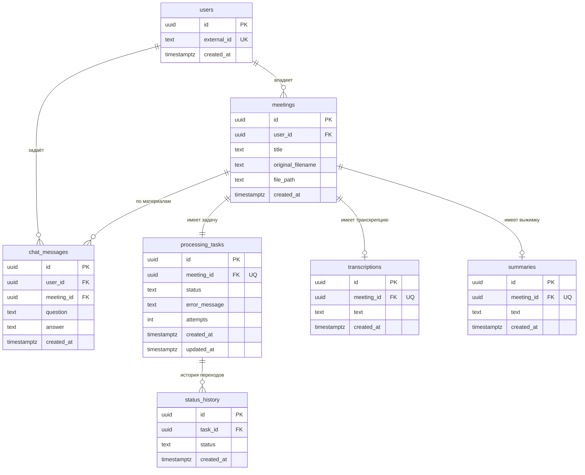

# Модель данных

Документ описывает схему PostgreSQL: сущности, связи, индексы, транзакции
и план запросов под каждый use case.

---

## 1. ER-диаграмма



---

## 2. Таблицы

### 2.1. `users`

```sql
CREATE TABLE users (
    id          UUID        PRIMARY KEY DEFAULT gen_random_uuid(),
    external_id TEXT        NOT NULL UNIQUE,
    token_hash  TEXT        NOT NULL UNIQUE,
    created_at  TIMESTAMPTZ NOT NULL DEFAULT now()
);
```

| Поле | Назначение |
|---|---|
| `external_id` | Идентификатор пользователя из CLI (`--user alice`). `UNIQUE` — дубликат при `Register` даёт `ErrAlreadyExists`. |
| `created_at` | Момент регистрации. |

`external_id` — единственный идентификатор, который видит пользователь.
Внутренние FK используют `id` (UUID). Это защищает от «утечки» чужих
`external_id` через логи и ошибки.

### 2.2. `meetings`

```sql
CREATE TABLE meetings (
    id                UUID        PRIMARY KEY DEFAULT gen_random_uuid(),
    user_id           UUID        NOT NULL REFERENCES users(id) ON DELETE CASCADE,
    title             TEXT        NOT NULL,
    original_filename TEXT        NOT NULL,
    file_path         TEXT        NOT NULL,
    created_at        TIMESTAMPTZ NOT NULL DEFAULT now()
);
CREATE INDEX idx_meetings_user_created ON meetings (user_id, created_at DESC);
```

| Поле | Назначение |
|---|---|
| `title` | Отображаемое название. По умолчанию — `basename(path)` без расширения. |
| `original_filename` | Имя загруженного файла (аудит). |
| `file_path` | Путь к сохранённой копии в `MS_UPLOAD_DIR`. Относительный от корня проекта. |

`ON DELETE CASCADE` от `users` — упрощает очистку в тестах; в реальной
эксплуатации удаление пользователя не предусмотрено.

### 2.3. `processing_tasks`

```sql
CREATE TABLE processing_tasks (
    id            UUID        PRIMARY KEY DEFAULT gen_random_uuid(),
    meeting_id    UUID        NOT NULL REFERENCES meetings(id) ON DELETE CASCADE,
    status        TEXT        NOT NULL
                  CHECK (status IN ('created','processing','transcribed',
                                    'summarized','completed','failed')),
    error_message TEXT,
    attempts      INT         NOT NULL DEFAULT 0,
    created_at    TIMESTAMPTZ NOT NULL DEFAULT now(),
    updated_at    TIMESTAMPTZ NOT NULL DEFAULT now(),
    UNIQUE (meeting_id)
);
CREATE INDEX idx_tasks_status ON processing_tasks (status);
```

| Поле | Назначение |
|---|---|
| `meeting_id` | `UNIQUE` — одна встреча = одна активная задача. Повторная загрузка создаёт новую встречу. |
| `status` | Один из шести. `CHECK` — страховка от опечаток в SQL. |
| `error_message` | Заполнен только при `failed`. `NULL` в остальных статусах. |
| `attempts` | Инкрементируется при каждом переходе `created → processing`. Для будущей логики ретраев; на текущий момент информативно. |

`updated_at` обновляется в каждом `UPDATE` явно (`SET updated_at = now()`)
— без триггеров, чтобы поведение было видно в коде.

### 2.4. `status_history`

```sql
CREATE TABLE status_history (
    id         UUID        PRIMARY KEY DEFAULT gen_random_uuid(),
    task_id    UUID        NOT NULL REFERENCES processing_tasks(id) ON DELETE CASCADE,
    status     TEXT        NOT NULL,
    created_at TIMESTAMPTZ NOT NULL DEFAULT now()
);
CREATE INDEX idx_status_history_task ON status_history (task_id, created_at);
```

| Поле | Назначение |
|---|---|
| `status` | Статус, в который перешла задача. |

Журнал фиксирует **последовательность статусов**, а не переходы «было → стало».
Предыдущий статус восстанавливается по соседней записи (в CLI `status --verbose`).
Такой дизайн:

- не требует дополнительного `SELECT` перед каждым `UPDATE` статуса;
- исключает рассинхрон `old_status(N) != new_status(N-1)`;
- при этом полностью сохраняет аудит жизненного цикла.

Пишется в **той же транзакции**, что и сам переход. При откате транзакции
записи истории не остаётся — «фантомных» переходов не бывает.

### 2.5. `transcriptions`

```sql
CREATE TABLE transcriptions (
    id         UUID        PRIMARY KEY DEFAULT gen_random_uuid(),
    meeting_id UUID        NOT NULL UNIQUE REFERENCES meetings(id) ON DELETE CASCADE,
    text       TEXT        NOT NULL,
    created_at TIMESTAMPTZ NOT NULL DEFAULT now()
);
CREATE INDEX idx_transcriptions_fts
    ON transcriptions USING GIN (to_tsvector('simple', text));
```

`UNIQUE(meeting_id)` — повторное сохранение транскрипции для той же встречи
невозможно (что корректно: встреча обрабатывается один раз).

### 2.6. `summaries`

```sql
CREATE TABLE summaries (
    id         UUID        PRIMARY KEY DEFAULT gen_random_uuid(),
    meeting_id UUID        NOT NULL UNIQUE REFERENCES meetings(id) ON DELETE CASCADE,
    text       TEXT        NOT NULL,
    created_at TIMESTAMPTZ NOT NULL DEFAULT now()
);
CREATE INDEX idx_summaries_fts
    ON summaries USING GIN (to_tsvector('simple', text));
```

### 2.7. `chat_messages`

```sql
CREATE TABLE chat_messages (
    id         UUID        PRIMARY KEY DEFAULT gen_random_uuid(),
    user_id    UUID        NOT NULL REFERENCES users(id) ON DELETE CASCADE,
    meeting_id UUID        NOT NULL REFERENCES meetings(id) ON DELETE CASCADE,
    question   TEXT        NOT NULL,
    answer     TEXT        NOT NULL,
    created_at TIMESTAMPTZ NOT NULL DEFAULT now()
);
CREATE INDEX idx_chat_user_meeting ON chat_messages (user_id, meeting_id, created_at DESC);
```

`user_id` дублируется (хотя выводим из `meeting_id`) — чтобы `History()`
не требовал JOIN с `meetings`. Дублирование согласовано с `meeting_id` при
`INSERT` в `ChatService` и проверяется там же.

---

## 3. Индексы: план запросов

SQL-запросы из этого раздела лежат в `internal/infra/postgres/queries/*.sql`
и компилируются `sqlc` в `sqlcgen/`. Имена функций в тексте (`ListMeetingsByUser`,
`SearchMeetings`, `GetMeetingForUser` и т.д.) совпадают с именами в `queries/*.sql`
и с именами методов в `sqlcgen/`.

### `idx_meetings_user_created` → `ListMeetingsByUser` (команда `list`)

```sql
-- name: ListMeetingsByUser :many
SELECT m.id, m.title, m.created_at,
       t.status,
       COALESCE(s.text, '') AS summary
FROM meetings m
JOIN processing_tasks t ON t.meeting_id = m.id
LEFT JOIN summaries s   ON s.meeting_id = m.id
WHERE m.user_id = $1
ORDER BY m.created_at DESC
LIMIT $2 OFFSET $3;
```

Индекс `(user_id, created_at DESC)` покрывает и `WHERE`, и `ORDER BY` — Index Scan
без Sort. Join идёт по PK (`processing_tasks.meeting_id` — UNIQUE) и UNIQUE (`summaries.meeting_id`).

`COALESCE(s.text, '')` — чтобы `sqlc` сгенерировал `string`, а не `*string`.
В `application.MeetingRepo.ListByUser` пустая строка превращается в `""`,
CLI-слой отображает `—`.

### `idx_tasks_status` → `ListPendingTasks` / `ResetStaleProcessing`

```sql
-- name: ListPendingTasks :many
SELECT id FROM processing_tasks
WHERE status IN ('created', 'transcribed', 'summarized');

-- name: ResetStaleProcessing :many
UPDATE processing_tasks
SET status = 'created', updated_at = now()
WHERE status = 'processing'
RETURNING id;
```

`ListPendingTasks` покрывает три незавершённых статуса: `created` (задача
ещё не взята), `transcribed` (транскрипция сохранена, но LLM-этап не завершён),
`summarized` (выжимка сохранена, но нет `completed` — крэш между шагами).
`ResetStaleProcessing` использует `UPDATE ... RETURNING` — одна операция;
в `status_history` не пишет, потому что это восстановление после сбоя,
а не бизнес-переход.

### `idx_transcriptions_fts` / `idx_summaries_fts` → `SearchMeetings` (команда `find`)

```sql
-- name: SearchMeetings :many
SELECT m.id, m.title, m.created_at, t.status,
       ts_headline('simple', COALESCE(s.text, tr.text), q,
                   'MaxFragments=1,MaxWords=15') AS snippet
FROM meetings m
JOIN processing_tasks t ON t.meeting_id = m.id
LEFT JOIN summaries s   ON s.meeting_id = m.id
LEFT JOIN transcriptions tr ON tr.meeting_id = m.id
CROSS JOIN websearch_to_tsquery('simple', $2) q
WHERE m.user_id = $1
  AND (to_tsvector('simple', COALESCE(s.text, '')) @@ q
    OR to_tsvector('simple', COALESCE(tr.text, '')) @@ q)
ORDER BY m.created_at DESC
LIMIT 50;
```

GIN-индексы ускоряют `@@` на обеих таблицах. `user_id = $1` фильтруется
после join — при количестве встреч на пользователя в десятки-сотни
это дешевле, чем отдельный индекс по `(user_id, tsvector)` (последний
занимал бы много места и требовал бы функционального GIN).

**Возможная проблема с `sqlc`.** `ts_headline` возвращает `text`, и `sqlc`
должен вывести `Snippet string`. Если генератор не справится с типом
`tsquery` в `websearch_to_tsquery('simple', $2)` — добавляется override
в `sqlc.yaml` (привести `$2` к `text` через `::text`) либо метод `Search`
пишется напрямую через `pgxpool.Query`. Это единственный запрос, для которого
допускается гибридное решение; фиксируется в ADR.

### `chat_messages` → `HistoryChatMessages` (для будущего `chat --history`)

```sql
-- name: HistoryChatMessages :many
SELECT question, answer, created_at
FROM chat_messages
WHERE user_id = $1 AND meeting_id = $2
ORDER BY created_at DESC
LIMIT 20;
```

Индекс `(user_id, meeting_id, created_at DESC)` — Index Scan.

### Почему `tsvector('simple')`, а не `russian`

Конфигурация `'simple'` не делает стемминга и работает одинаково для любых
языков. Для встреч на русском это означает:
- поиск точных словоформ («бюджет» найдёт «бюджет», но не «бюджета»);
- для большинства практических запросов это приемлемо.

Переход на `'russian'` — одна миграция (`to_tsvector('russian', text)` +
пересоздание индекса), бизнес-логика не затрагивается. Зафиксировано в ADR.

---

## 4. Транзакции

Все переходы статусов атомарны. Реализация — в `internal/infra/postgres/repo/*.go`
(пакет `repo`): `pgxpool.Begin` → `queries.WithTx(tx)` → `tx.Commit` /
`defer tx.Rollback(ctx)`. Каждый запрос внутри транзакции описан в
`queries/tasks.sql` (или `queries/meetings.sql`) и вызывается через
`sqlcgen.Queries`, привязанный к транзакции.

| # | Метод (обёртка) | SQL-функции sqlcgen внутри транзакции | Атомарные операции |
|---|---|---|---|
| 1 | `MeetingRepo.CreateWithTask` | `CreateMeeting`, `CreateTask`, `InsertStatusHistory` | `INSERT meetings` → `INSERT processing_tasks(status='created')` → `INSERT status_history(status='created')` |
| 2 | `TaskRepo.MarkProcessing` | `MarkTaskProcessing`, `InsertStatusHistory` | `UPDATE processing_tasks SET status='processing', attempts=attempts+1, updated_at=now()` → `INSERT status_history(status='processing')` |
| 3 | `TaskRepo.SaveTranscriptionAndMarkTranscribed` | `InsertTranscription`, `MarkTaskTranscribed`, `InsertStatusHistory` | `INSERT transcriptions` → `UPDATE processing_tasks SET status='transcribed', updated_at=now()` → `INSERT status_history(status='transcribed')` |
| 4 | `TaskRepo.SaveSummaryAndMarkSummarized` | `InsertSummary`, `MarkTaskSummarized`, `InsertStatusHistory` | `INSERT summaries` → `UPDATE processing_tasks SET status='summarized', updated_at=now()` → `INSERT status_history(status='summarized')` |
| 5 | `TaskRepo.MarkCompleted` | `MarkTaskCompleted`, `InsertStatusHistory` | `UPDATE processing_tasks SET status='completed', updated_at=now()` → `INSERT status_history(status='completed')` |
| 6 | `TaskRepo.MarkFailed` | `MarkTaskFailed`, `InsertStatusHistory` | `UPDATE processing_tasks SET status='failed', error_message=$1, updated_at=now()` → `INSERT status_history(status='failed')` |

**Почему `MarkProcessing` — транзакция.** Формально можно было бы сделать один
`UPDATE` и не писать историю. Но `attempts` — счётчик, и переход
`created → processing` должен быть виден в истории. Писать историю «вне»
основного `UPDATE` — значит допустить ситуацию «статус сменился, а в истории
нет записи» при падении между запросами. Один атомарный блок решает это.

**Почему `MarkCompleted` — транзакция.** По той же причине: `UPDATE status`
и `INSERT status_history` должны попасть в БД вместе.

**Что не в транзакции.** `ChatService.Ask` вызывает `LLMClient.Answer`
и затем `ChatRepo.Save`. Если LLM ответил, а `Save` упал — пользователь
получит ответ, но в истории его не будет. Это осознанный компромисс: ответ
не критичен для консистентности встречи, а в случае `Save`-ошибки пользователь
увидит ошибку и сможет повторить вопрос.

---

## 5. Связь с требованием разграничения прав

Все read-методы `MeetingRepo` содержат `WHERE m.user_id = $1`:

| Метод | SQL-запрос | Гарантия |
|---|---|---|
| `ListByUser(userID)` | `ListMeetingsByUser` | `WHERE m.user_id = $1` |
| `GetByIDForUser(meetingID, userID)` | `GetMeetingForUser` | `WHERE m.id = $1 AND m.user_id = $2`; при отсутствии строки → `domain.ErrNotFound` (не `ErrForbidden` — не раскрываем существование чужой встречи) |
| `Search(userID, query)` | `SearchMeetings` | `WHERE m.user_id = $1 AND (FTS-условие)` |
| `GetTranscript(meetingID, userID)` | `GetTranscriptForUser` | `JOIN meetings m ON … WHERE m.user_id = $2` |
| `GetSummary(meetingID, userID)` | `GetSummaryForUser` | аналогично |

Решение «`ErrNotFound` вместо `ErrForbidden`» — стандартная практика
для API, отдающих данные по ID: не подтверждаем существование чужих
объектов. Зафиксировано в ADR.

**Маппинг ошибок — на обёртке `repo/*.go`.** `sqlcgen` возвращает
`pgx.ErrNoRows`; обёртка переводит его в `domain.ErrNotFound`:

```go
if errors.Is(err, pgx.ErrNoRows) {
    return nil, domain.ErrNotFound
}
```

`application` и `domain` про `pgx` не знают.

---

## 6. Миграции и sqlc

`golang-migrate/migrate` + `embed.FS`. Файлы:

```
internal/infra/postgres/migrations/
  0001_init.up.sql
  0001_init.down.sql
```

Запуск — при старте `main.go` (если `MS_MIGRATE_ON_START=true`) или вручную
через `make migrate-up`. На старте удобнее для локальной разработки;
в продакшене — отдельным шагом деплоя (флаг `false`).

### 6.1. Связь с sqlc

`sqlc` не читает `migrations/` — он парсит **конечное состояние схемы**
из `internal/infra/postgres/schema.sql`. Правило:

- при добавлении миграции `000N_*.sql` — синхронно обновить `schema.sql`;
- при изменении `schema.sql` — прогнать `make sqlc` и закоммитить
  изменения в `sqlcgen/`;
- CI проверяет синхронизацию через `make sqlc-check` (`sqlc diff`).

SQL-запросы для `sqlc` живут в `internal/infra/postgres/queries/`:

```
queries/
  users.sql          EnsureUser, GetUserByExternalID
  meetings.sql       CreateMeeting, GetMeetingForUser, ListMeetingsByUser,
                     GetMeetingByTaskID, SearchMeetings
  tasks.sql          CreateTask, GetTaskByID, GetTaskForMeetingAndUser,
                     MarkTaskProcessing, MarkTaskTranscribed, MarkTaskSummarized,
                     MarkTaskCompleted, MarkTaskFailed,
                     InsertStatusHistory, ListStatusHistory,
                     ResetStaleProcessing, ListPendingTasks
  transcriptions.sql InsertTranscription, GetTranscriptForUser
  summaries.sql      InsertSummary, GetSummaryForUser
  chat.sql           SaveChatMessage, HistoryChatMessages
```

### 6.2. Синхронизация `schema.sql` с миграциями

`schema.sql` — кумулятивная схема «как в проде сейчас». Он пишется один раз
для `0001_init` и дополняется при каждой следующей миграции.

Пример: появилась миграция `0002_add_meeting_tags.up.sql` с
`ALTER TABLE meetings ADD COLUMN tags TEXT[]`. Тогда:

1. В `migrations/0002_add_meeting_tags.up.sql` — сам `ALTER`.
2. В `migrations/0002_add_meeting_tags.down.sql` — обратный `ALTER TABLE meetings DROP COLUMN tags`.
3. В `schema.sql` — итоговая строка `tags TEXT[]` в `CREATE TABLE meetings`.
4. `make sqlc` — перегенерирует `sqlcgen/models.go`, `sqlcgen/meetings.sql.go`.
5. `sqlcgen/` коммитится.

Если пропустить шаг 3 — `sqlc` сгенерирует код под старую схему, компиляция
пройдёт, но в рантайме `SELECT *` упадёт на несоответствии колонок. CI-проверка
`sqlc diff` этого не поймает (она сверяет `sqlcgen` с `schema.sql`, а не
`migrations/`), поэтому шаг 3 — дисциплина разработчика. Альтернатива —
генерировать `schema.sql` из свежей БД (`pg_dump --schema-only`) в Makefile,
но для проекта такого размера достаточно ручной синхронизации.

### 6.3. Что коммитится

| Артефакт | Коммитится? |
|---|---|
| `migrations/*.sql` | Да |
| `schema.sql` | Да |
| `queries/*.sql` | Да |
| `sqlc.yaml` | Да |
| `sqlcgen/*.go` | Да (чтобы `go build` работал без установки `sqlc`) |
